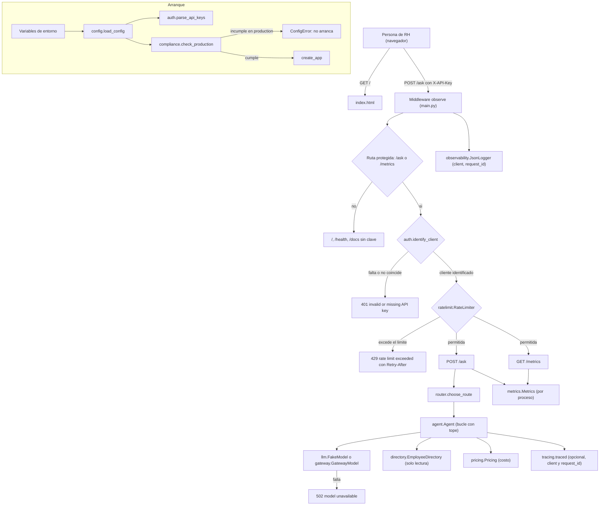
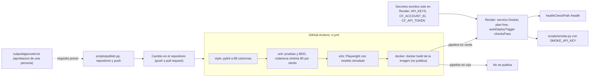

# Arquitectura del HR Assistant

Asistente de Recursos Humanos que responde preguntas sobre empleados a través de una API web sin estado y una página web. Este documento resume la arquitectura final (sesiones 1 a 4) y remite a los ADR para cada decisión. Todos los datos de ejemplo son ficticios.

Fuentes: `spec/01-architecture.md` a `spec/04-production.md`, los ADR 0001 a 0012, el código de `product/app/` y `doc/image-vulnerabilities.md`.

## Diagrama de la aplicación

Las reglas de compliance se evalúan al crear la aplicación (`create_app`) y también al importar `app.main` (`validate_environment`). Con `ENVIRONMENT=production` el servicio no arranca si incumple alguna regla ([ADR 0011](adr/0011-compliance-as-code-fail-closed.md)).

## Diagrama de entrega

La imagen se construye con `product/Dockerfile` (`python:3.12-slim`, usuario sin privilegios, `uvicorn` en `${PORT:-8000}`) y `.dockerignore` deja fuera `.env`, `tests/`, `e2e/` y los cachés ([ADR 0012](adr/0012-container-ci-gated-deploy.md)). La publicación sigue condicionada a la aprobación de una persona; hoy está EN PAUSA (véase «Pendiente de decisión humana»).

## Módulos de `product/app/`

| Archivo | Responsabilidad |
| --- | --- |
| `__init__.py` | Marca el paquete del HR Assistant. |
| `main.py` | `create_app` y el middleware: asigna `request_id`, aplica clave y límite en `/ask` y `/metrics`, registra la petición, atiende fallos (`500`, `502`) y ejecuta compliance al crear la app. |
| `config.py` | Lee y valida las variables de entorno en una configuración inmutable; `api_keys` y `cf_api_token` quedan fuera de `repr`. |
| `errors.py` | Define `ConfigError`, el error que impide arrancar, sin valores secretos. |
| `auth.py` | Analiza `API_KEYS` e identifica al cliente por `X-API-Key` con `hmac.compare_digest`; los errores dan posición y largo, nunca el valor. |
| `ratelimit.py` | Ventana deslizante de 60 s por cliente autenticado con reloj inyectado; devuelve si permite y los segundos de espera (mínimo 1 al negar). |
| `compliance.py` | Función pura que lista las reglas de producción incumplidas, sin valores. |
| `observability.py` | `request_id` por petición, `client_var` y `JsonLogger` con un evento JSON por línea. |
| `tracing.py` | Adaptador opcional de LangSmith con ocultamiento de entradas y salidas; agrega `client` a los metadatos. |
| `metrics.py` | Contadores por proceso: peticiones, tasa de error, latencias p50 y p95, tokens y costo. |
| `clock.py` | Relojes inyectables (`SystemClock`, `FixedClock`, `SteppingClock`); único lugar con la hora real. |
| `agent.py` | Agente único con bucle acotado y herramientas de solo lectura; recorta el historial, acumula tokens y costo y emite `agent_run` y `audit`. |
| `llm.py` | Interfaz `Model` (`complete`), `ModelResponse`, `ModelUnavailable` y el modelo simulado determinista. |
| `gateway.py` | Modelo real: Cloudflare Workers AI a través de AI Gateway con `httpx`; caché opcional y token solo en el encabezado `Authorization`. |
| `models.py` | Arma un modelo por cada nombre configurado (simulado o de gateway). |
| `router.py` | Regla en código que elige `MODEL_SMALL` o `MODEL_LARGE` por pregunta y devuelve el motivo. |
| `pricing.py` | Carga la tabla de precios y calcula el costo de cada llamada. |
| `directory.py` | Directorio de empleados en memoria, de solo lectura, cargado de `data/employees.json`. |
| `static/index.html` | Página única: campo de clave de tipo contraseña en `sessionStorage`, `X-API-Key`, mensajes para `401` y `429`, texto con `textContent`. |

## Flujo de una pregunta

1. La persona escribe la clave en la página (se guarda en `sessionStorage`) y la pregunta; el navegador envía `POST /ask` con `X-API-Key` y el historial.
2. El middleware asigna `request_id` (el de `X-Request-ID` si es válido, o un UUID) y reconoce que `/ask` es una ruta protegida.
3. `auth.identify_client` busca al cliente dueño de la clave; si falta o no coincide responde `401` con `invalid or missing API key`. Si coincide, fija `client` en el contexto.
4. `ratelimit.RateLimiter` cuenta la petición del cliente; si supera `RATE_LIMIT_PER_MINUTE` responde `429` con `Retry-After`.
5. La API valida la pregunta (vacía o más larga que `MAX_QUESTION_CHARS` responde `422`).
6. `router.choose_route` elige el modelo y el motivo; el agente recorta el historial a `HISTORY_WINDOW` y recorre el bucle: el modelo pide una herramienta o responde, hasta `AGENT_MAX_STEPS`.
7. Si el modelo falla responde `502` con `model unavailable`.
8. Se registran `agent_run`, `audit` y `request`, todos con `client` y sin texto de preguntas ni respuestas ni la clave; se actualizan las métricas y la traza opcional lleva `client` y `request_id`.
9. La respuesta vuelve con `request_id`, `answer`, `steps`, `tools_used`, tokens, `model`, `route`, `cached_calls` y `cost_usd`. La página la muestra, o muestra «Clave inválida» (`401`) o «Demasiadas preguntas; espera N segundos» (`429`, con N de `Retry-After`).

## Decisiones de arquitectura (ADR)

| ADR | Decisión |
| --- | --- |
| [0001](adr/0001-stateless-api.md) | API sin estado |
| [0002](adr/0002-model-interface-fake-provider.md) | Modelo detrás de una interfaz, con proveedor simulado |
| [0003](adr/0003-bounded-agent-loop.md) | Agente de bucle con tope y herramientas de solo lectura |
| [0004](adr/0004-request-id-and-json-logs.md) | Id por petición y log JSON sin contenido de usuario |
| [0005](adr/0005-per-process-metrics.md) | Métricas por proceso y SLO de latencia |
| [0006](adr/0006-optional-langsmith-tracing.md) | Trazas opcionales en LangSmith con privacidad por omisión |
| [0007](adr/0007-rule-based-model-routing.md) | Enrutamiento de modelo con una regla en código |
| [0008](adr/0008-cost-accounting-per-response.md) | Costo por respuesta calculado en la aplicación |
| [0009](adr/0009-gateway-provider-fail-closed.md) | Proveedor gateway con configuración estricta y fallo controlado |
| [0010](adr/0010-api-key-per-client-and-rate-limit.md) | Clave por cliente y límite de peticiones en el middleware |
| [0011](adr/0011-compliance-as-code-fail-closed.md) | Compliance como código: negarse a arrancar en producción |
| [0012](adr/0012-container-ci-gated-deploy.md) | Contenedor y despliegue condicionado al pipeline de CI |

## Limitación aceptada: intentos con clave inválida

Los intentos con clave inválida no tienen límite por origen. Solo el cliente autenticado tiene límite de peticiones (`ratelimit.py` se aplica después de `auth.py`). La mitigación es doble: claves de al menos 16 caracteres, que `check_production` exige, y comparación en tiempo constante con `hmac.compare_digest`. Esta limitación la aprobó la persona responsable del plan y está detallada en el [ADR 0010](adr/0010-api-key-per-client-and-rate-limit.md) y en la [lista de compliance](compliance-checklist.md). Si se requiere limitar intentos fallidos por origen, debe decidirse en un nuevo ADR.

## Documentos de entrega relacionados

- [Verificación de la imagen base y vulnerabilidades](image-vulnerabilities.md): la persona eligió la opción (b) el 2026-11-14 y `product/Dockerfile` se modificó para actualizar `zlib1g` durante la construcción. Las pruebas unitarias pasan (109 pruebas, cobertura 96,57 %). La imagen `hr-assistant:revision` no se pudo construir porque Docker Engine no está en ejecución: el estado es PENDIENTE por bloqueo y no se ha verificado la versión de zlib instalada ni la desaparición de CVE-2026-85091 y CVE-2026-76844. Publicación EN PAUSA.
- [Lista de compliance de producción](compliance-checklist.md).

## Pendiente de decisión humana

- La autenticación por clave resuelve el acceso a la API, pero siguen sin definirse el acceso y la retención de los logs. Debe definirse antes de usar datos reales de personal.
- Con el proveedor `gateway`, el contenido de las preguntas y los datos del directorio salen hacia un tercero: se requiere autorización institucional previa.
- El límite de peticiones es por proceso; si se escala a varias copias debe revisarse (ADR 0010).
- Falta el nombre del repositorio, que será también el nombre del servicio en Render.
- Imagen base (`image-vulnerabilities.md`): el escaneo de la imagen base (0 críticas y 2 altas en zlib: CVE-2026-85091 y CVE-2026-76844) fue reproducido el 2026-11-14 con Docker Scout v1.28.0. Ninguna imagen oficial de Python 3.12 evaluada incluye la corrección. La persona eligió la opción (b) y el Dockerfile se modificó con un `RUN` que actualiza `zlib1g` (se conserva `FROM python:3.12-slim` sin digest). Construcción BLOQUEADA: Docker Engine no está en ejecución, así que falta construir `hr-assistant:revision`, registrar la versión de zlib, escanear la imagen final, comprobar las dos CVE, arrancar el contenedor con claves ficticias y ejecutar `scripts/smoke.py`; nada de esto está verificado. Si apt no encuentra la versión corregida, la construcción no falla y las CVE seguirían presentes; solo el escaneo lo determina. La persona debe confirmar que Render usa `linux/amd64` y decidir si se fija el Dockerfile al digest del índice. Publicación EN PAUSA.
