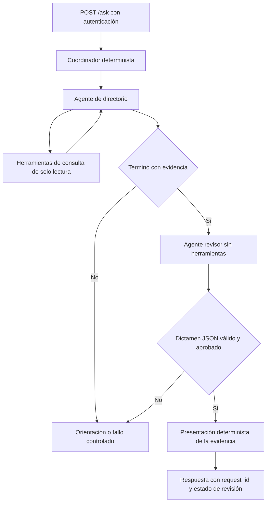

# Arquitectura multiagente del reto

La API ejecuta dos agentes basados en modelo y un coordinador determinista.
Compartir el proveedor no implica compartir su conversación: el revisor recibe
un contexto nuevo con pregunta, borrador y evidencia, nunca el historial completo.

## Responsabilidades y límites

- Coordinador: delega, aplica las condiciones de paso y suma el consumo total.
- Directorio: selecciona herramientas y redacta un borrador con un máximo de
  AGENT_MAX_STEPS llamadas al modelo. Sus herramientas son get_employee y
  search_by_department; no escribe datos.
- Revisor: una única llamada adicional con instrucciones independientes; responde
  exactamente con approved booleano. Formato incorrecto equivale a rechazo.
- Presentación: una aprobación no permite publicar prosa libre del modelo.
  Se muestran únicamente campos permitidos de los registros consultados.
  Esto evita añadir al resultado salarios u otras afirmaciones del borrador.

El máximo es AGENT_MAX_STEPS + 1 llamadas, sin bucles de revisión. La API conserva
steps como pasos del directorio y añade review_calls, review_status y agents_used.
Los tokens, costo y llamadas cacheadas incluyen al revisor. Su costo se calcula
con el mismo modelo elegido para la solicitud; no se afirma ahorro hasta medirlo.

## Observabilidad

Las trazas son coordinator > directory_agent > agent_run/model_call/tool_call
y coordinator > reviewer_agent > reviewer_model_call. Eventos handoff y
workflow_completed incluyen el request_id mediante el logger existente.
Estos eventos no contienen pregunta, borrador ni registros. La auditoría heredada
de herramientas sí contiene sus argumentos: su política de PII sigue pendiente.

## Qué está probado y qué falta

Las pruebas locales usan FakeModel y dictámenes guionados para verificar contratos,
rechazo, consumo, límites, aislamiento y jerarquía de trazas. FakeModel aprueba
la revisión por regla: no simula una evaluación semántica real.
La prueba de hilos verifica aislamiento en memoria, no capacidad bajo carga de HTTP.

Pendiente: evaluación semántica con Cloudflare, trazas visibles en LangSmith,
prueba HTTP de concurrencia, controles de PII completos, costos reales y despliegue.
No se presenta la captura local como prueba del proveedor real.
